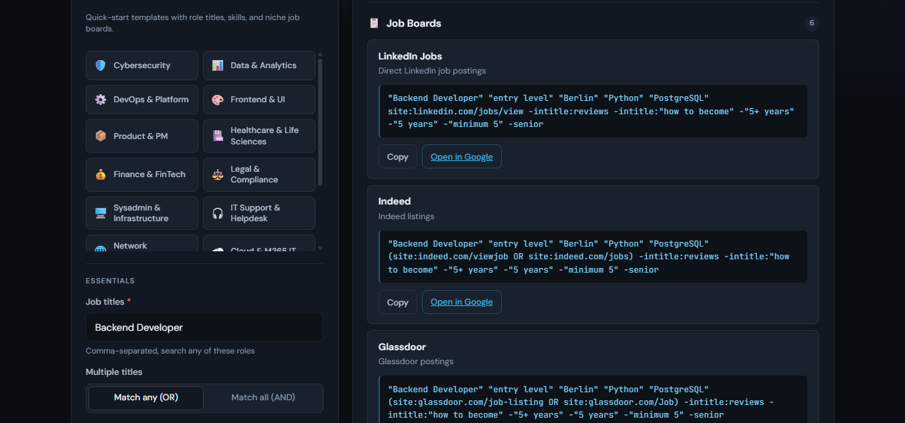

<div align="center">


# JobScout Dorks

**Turn a job title, a few skills, and a location into precise Google searches that reach company career pages and ATS boards before the aggregators do.**

[](https://github.com/AymenBoukadida/JobDork/actions/workflows/ci.yml)
[](https://www.python.org/)
[](https://fastapi.tiangolo.com/)
[](LICENSE)

[Why](#why-this-exists) · [Features](#features) · [Quick start](#quick-start) · [Query anatomy](#how-a-query-is-built) · [API](#api-reference) · [Presets](#presets) · [Tunisia](#tunisia-mode)

</div>

---

## Why this exists

A company publishes a role on its own careers page or ATS board first. LinkedIn and Indeed re-index it hours or days later, often behind a search limit or an account wall. JobScout Dorks builds the Google queries that reach the source: employer career sites, hosted ATS boards, and niche/regional job boards.

It is a query generator, not a scraper. It never fetches Google or any job site — every query is a URL you open yourself.

<p align="center">
  
</p>

## Features

- **42 queries from a single title** — 6 job boards, 16 ATS backends, 6 remote boards, 5 company-direct angles, 4 tech sources, and 5 advanced patterns. A company name, target domains, or a preset adds more.
- **ATS-first coverage** — Greenhouse, Lever, Ashby, Workday, SmartRecruiters, BambooHR, iCIMS, Jobvite, Workable, Teamtailor, Recruitee, Pinpoint, Breezy HR, JazzHR, Taleo, and UKG Pro.
- **Company targeting** — pass `stripe.com, monzo.com` and get one query per domain plus a combined one; pass a company name and get its own site (with boards subtracted) and its hosted ATS board.
- **16 domain presets** — cybersecurity, data, DevOps, frontend, backend, mobile, product, healthcare, finance, legal, sysadmin, IT support, network, cloud/M365, general IT, and Tunisia.
- **Localized experience filters** — entry/junior searches in Tunisia match `junior`, `débutant`, `jeune diplômé`, `SIVP`, and `PFE`, not just the English phrase.
- **Recency and exclusions** — `after:` filters, recruiter/seniority suppression, and default removal of review pages and "how to become" content.
- **CV pre-fill** — upload a PDF, DOCX, or TXT résumé and the form is populated in memory. Nothing is stored.
- **No build step** — FastAPI serves pre-rendered HTML, one stylesheet, and plain ES modules.

## Quick start

Python 3.12+ is required.

```bash
python -m venv .venv
.venv\Scripts\activate        # Windows
# source .venv/bin/activate   # macOS/Linux

pip install -r requirements.txt
uvicorn app.main:app --reload
```

Open <http://127.0.0.1:8000>.

### Docker

```bash
docker build -t jobscout-dorks .
docker run --rm -p 8000:8000 jobscout-dorks
```

The image runs as an unprivileged user on `python:3.12-slim` and exposes a `HEALTHCHECK` against `/api/health`.

## How a query is built

Every dork is assembled from a **core** (what to match) and a **protected** suffix (site filters, exclusions). Protected parts survive length trimming, so a query never loses its `site:` operator or its exclusions.

A real generated query, entry-level in Tunisia:

```text
"Backend Developer" ("entry level" OR junior OR débutant OR "jeune diplômé" OR "0-2 ans" OR SIVP OR PFE)
"Tunis" "Python" after:2026-10-18 site:linkedin.com/jobs/view
-intitle:reviews -intitle:"how to become" -intitle:formation -"5+ years" -"5 years" -"minimum 5" -senior
```

| Part | Purpose |
|------|---------|
| `"Backend Developer"` | Job title. Multiple titles become one `OR`/`AND` group. |
| `("entry level" OR junior OR …)` | Experience clause, localized for Tunisia. |
| `"Tunis"` | Location phrase. |
| `"Python"` | Skill group, `OR` or `AND` depending on keyword mode. |
| `after:2026-10-18` | Recency filter derived from the selected time window. |
| `site:linkedin.com/jobs/view` | Scope of this particular dork. |
| `-intitle:reviews …` | Noise suppression, always applied. |

### Query limits

| Limit | Value | Behaviour |
|-------|-------|-----------|
| Hard cap | 1 800 characters | Exclusions and `site:` are preserved, the core is trimmed. |
| Soft warning | 1 500 characters | Query is still emitted and flagged in `query_warning`. |
| Truncation flag | `truncated: true` | Set on any query that lost part of its core. |

## What it generates

| Category | Covered sources |
|----------|-----------------|
| Job Boards | LinkedIn, Indeed, Glassdoor, ZipRecruiter, Monster, Dice |
| ATS Platforms | Greenhouse, Lever, Ashby, Workday, SmartRecruiters, BambooHR, iCIMS, Jobvite, Workable, Teamtailor, Recruitee, Pinpoint, Breezy HR, JazzHR, Taleo, UKG Pro |
| Remote Boards | We Work Remotely, Remote OK, Remotive, FlexJobs, Remote.co, Working Nomads |
| Company Direct | `/careers` pages, `/jobs` pages, hiring announcements, per-domain career and job queries, ATS board lookup, PDF postings, Wellfound/AngelList startup boards |
| Tech & Dev | Authentic Jobs, Arc.dev, GitHub hiring posts, Hacker News "Who's Hiring" |
| Advanced | Zero-experience roles, exact title match, recent postings, salary mentions, no-recruiter filter |
| Tunisia | TanitJobs, Option Carrière TN, Keejob, Indeed Tunisia, Tunisie Annonce, LinkedIn Tunisia, `.tn` sites |

Categories that depend on input only appear when relevant: `Company Direct` needs a company or domain, `Tunisia` needs the preset or a Tunisian location, `Domain Niche` needs a preset.

## Presets

Presets pre-fill titles, skills, and exclusions, and add sector-specific boards.

| Preset | Preset | Preset | Preset |
|--------|--------|--------|--------|
| Cybersecurity | Data & Analytics | DevOps & Platform | Frontend & UI |
| Backend & API | Mobile Development | Product & PM | Healthcare & Life Sciences |
| Finance & FinTech | Legal & Compliance | Sysadmin & Infrastructure | IT Support & Helpdesk |
| Network Engineering | Cloud & M365 IT | General IT | Tunisia |

## Experience targeting

Six levels are available: **Any level**, **No experience (0 yrs)**, **Entry / Junior**, **Mid**, **Senior**, **Lead / Staff**.

Each level adds a positive clause and a set of negative tokens. Entry level excludes `-senior`, `-"5+ years"`, `-"5 years"`, and `-"minimum 5"`; the zero-experience level goes further and also drops the 3- and 4-year phrasings.

`junior`, `jr`, `entry`, `sr`, `staff`, `principal`, and `zero` are accepted as aliases and normalized before use.

## Tunisia mode

Tunisia is enabled by the `tunisia` preset or by a Tunisian location (`Tunis`, `Sfax`, `Sousse`, `Bizerte`, `Nabeul`, `Gabès`, `Ariana`, `Monastir`, `Kairouan`).

**Localized experience clauses**

```text
Entry / Junior:
("entry level" OR junior OR débutant OR "jeune diplômé" OR "0-2 ans" OR SIVP OR PFE)

No experience:
("jeune diplômé" OR débutant OR "0-2 ans" OR "sans expérience" OR SIVP OR PFE OR "no experience required")
```

**Dedicated internship dork** (entry and no-experience only):

```text
("stage" OR PFE OR SIVP OR "jeune diplômé")
(site:tanitjobs.com OR site:keejob.com)
-intitle:formation -"5+ years" -senior
```

**Why `-intitle:formation` instead of `-formation`.** Training ads are the noise to remove, and they almost always carry "formation" in the title. The plain token would also strip legitimate job pages that merely mention "formation" in their sidebar, and TanitJobs uses that word in its page chrome. The title-scoped exclusion removes the ads and keeps the listings — including paid PFE offers whose titles never contain the word.

Live verification, 17 November 2026:

| Query | Results before | Results after |
|-------|---------------:|--------------:|
| TanitJobs, Entry / Junior | 0 | 132 000 |
| Tunisian `.tn`, Entry / Junior | 0 | 54 100 |
| `Stage / PFE / SIVP` (new) | — | 182 000 |
| TanitJobs, any level | 773 000 | 773 000 |

## API reference

All endpoints are JSON. Interactive docs are disabled (`docs_url=None`).

### `POST /api/dorks`

Builds the query set.

| Field | Type | Default | Notes |
|-------|------|---------|-------|
| `titles` | `string[]` | `[]` | One or more job titles. |
| `title` | `string` | `""` | Legacy single-title field. |
| `title_mode` | `"or" \| "and"` | `"or"` | How multiple titles combine. |
| `skills` | `string[]` | `[]` | Max four are used per query. |
| `keyword_mode` | `"or" \| "and"` | `"and"` | How skills combine. |
| `location` | `string` | `""` | City, region, or country. |
| `remote` | `bool` | `false` | Adds remote-oriented dorks and phrases. |
| `experience` | `string` | `""` | `no_experience`, `entry level`, `mid level`, `senior`, `lead`. |
| `exclude_terms` | `string[]` | `[]` | Extra negative tokens, normalized and de-duplicated. |
| `company` | `string` | `""` | Target company name. |
| `company_domains` | `string[]` | `[]` | Career-site domains, e.g. `["stripe.com"]`. |
| `ats_platforms` | `string[] \| null` | `null` | `null` = all, `[]` = none, otherwise a subset of platform ids. |
| `time_filter` | `string` | `""` | `24h`, `7d`, `30d`, `90d`, `180d`. |
| `preset_id` | `string` | `""` | One of the 16 preset ids. |

```bash
curl -X POST http://127.0.0.1:8000/api/dorks \
  -H "Content-Type: application/json" \
  -d '{
    "titles": ["Software Engineer", "Backend Developer"],
    "title_mode": "or",
    "location": "London",
    "skills": ["Python"],
    "time_filter": "30d",
    "preset_id": "cybersecurity",
    "company_domains": ["stripe.com", "monzo.com"]
  }'
```

Response shape:

```jsonc
{
  "params":   { "titles": ["Backend Developer"], "experience": "entry level", "preset_id": "tunisia" },
  "total":    51,
  "warnings": [],
  "categories": [
    {
      "id": "tunisia",
      "label": "Tunisia",
      "icon": "🇹🇳",
      "dorks": [
        {
          "label": "TanitJobs",
          "description": "Leading Tunisian job board",
          "query": "\"Backend Developer\" (\"entry level\" OR junior …) site:tanitjobs.com …",
          "google_url": "https://www.google.com/search?q=…",
          "platform_id": "tanitjobs",
          "truncated": false,
          "query_warning": null
        }
      ]
    }
  ]
}
```

### Other endpoints

| Method | Path | Returns |
|--------|------|---------|
| `GET` | `/` | The application page, with presets inlined for first paint. |
| `GET` | `/privacy` | Privacy policy. |
| `GET` | `/api/presets` | All presets with titles, skills, and exclusions. |
| `GET` | `/api/ats-platforms` | The 16 ATS backends and their `site:` filters. |
| `GET` | `/api/time-filters` | The five recency windows. |
| `GET` | `/api/health` | `{"status": "ok"}`. |
| `POST` | `/api/cv/parse` | Multipart `cv` upload → extracted title, location, skills, experience, and a remote hint. |

```bash
curl http://127.0.0.1:8000/api/presets
curl -X POST http://127.0.0.1:8000/api/cv/parse -F "cv=@resume.pdf"
```

### CV parsing

| Property | Value |
|----------|-------|
| Formats | PDF, DOCX, TXT, MD |
| Max size | 5 MB |
| Storage | None — parsed in memory, discarded after the response |
| Rate limit | 20 uploads per minute per client IP |

### Errors

| Status | Cause |
|--------|-------|
| `400` | No usable title, unsupported CV format, unreadable CV |
| `413` | CV over 5 MB, or request body over the limit |
| `429` | CV upload rate limit exceeded |

## Security and privacy

- No accounts, no database, no analytics, no third-party trackers.
- CVs and search parameters are processed per request and not persisted.
- Search history lives in `localStorage` on your device and is never uploaded.
- Every response carries CSP, `X-Content-Type-Options`, `X-Frame-Options: DENY`, `Referrer-Policy`, COOP, HSTS, and a restrictive `Permissions-Policy`.
- `POST` body size is capped before parsing.
- The server never contacts Google or any job site.

See [static/privacy.html](static/privacy.html) for the full policy.

## Project structure

```text
app/
  main.py              FastAPI app, routes, security headers, CV rate limit
  dork_engine.py       Query assembly, categories, presets integration
  query_builder.py     Term sanitizing, grouping, trimming, length caps
  experience_filters.py Experience clauses and exclusion tokens
  domain_presets.py    16 presets: titles, skills, exclusions, niche boards
  ats_platforms.py     16 ATS backends and their site filters
  career_pages.py      Career-path patterns, ATS board sites, aggregator exclusions
  time_filters.py      Recency windows → after:YYYY-MM-DD
  cv_parser.py         PDF/DOCX/TXT extraction
static/
  index.html           Single-page UI shell
  app.js               Form state, presets, history, rendering
  js/                  Payload contract, storage, toasts (ES modules)
  style.css            All styling
  privacy.html         Privacy policy
  favicon.svg          Logo
tests/
  test_*.py            Pytest suite (API, engine, filters, presets, quality)
  frontend/            Node test runner for the payload contract
```

## Development

```bash
pip install -r requirements-dev.txt

.venv\Scripts\python.exe -m pytest -q
node --test tests/frontend/payload.test.mjs
```

The frontend tests use Node's built-in test runner (Node 20+) — no `npm install` step and no runtime dependencies.

CI runs both suites on every push to `main` and on every pull request. Both jobs use pinned action SHAs and read-only token permissions.

## Deployment

The app is stateless and runs anywhere that can serve a Python 3.12 process:

- **Vercel** — the production instance at <https://jobdork-ochre.vercel.app>.
- **Docker** — build the image above and run it behind any reverse proxy.
- **Plain uvicorn** — `uvicorn app.main:app --host 0.0.0.0 --port 8000`.

## Limitations

- Google does not support `OR` between `inurl:` or `intitle:` operators. `(inurl:careers OR inurl:jobs)` returns **zero** results, with or without parentheses. The engine emits one dork per path instead: `inurl:careers` and `inurl:jobs`.
- Google may quietly relax a dork that is overloaded with operators, dropping filters and returning unrelated pages. If results look off-target, shorten the query: fewer exclusions, fewer skills, one title at a time.
- Google's `after:` operator filters on the page's index date, not the real posting date. Treat recency as approximate.
- Result counts vary by region, personalization, and Google's own throttling. Open links in a private window for cleaner results.
- The Tunisia preset is built around French-language postings; Arabic-language boards are only partially covered.
- Adding four or more skills with `keyword_mode: "and"` makes queries very restrictive, especially on regional boards. Prefer `"or"` when the result set is thin.
- Query length is capped, so extreme combinations are trimmed. Check `truncated` and `query_warning` if a query looks short.

## License

MIT. See [LICENSE](LICENSE).
